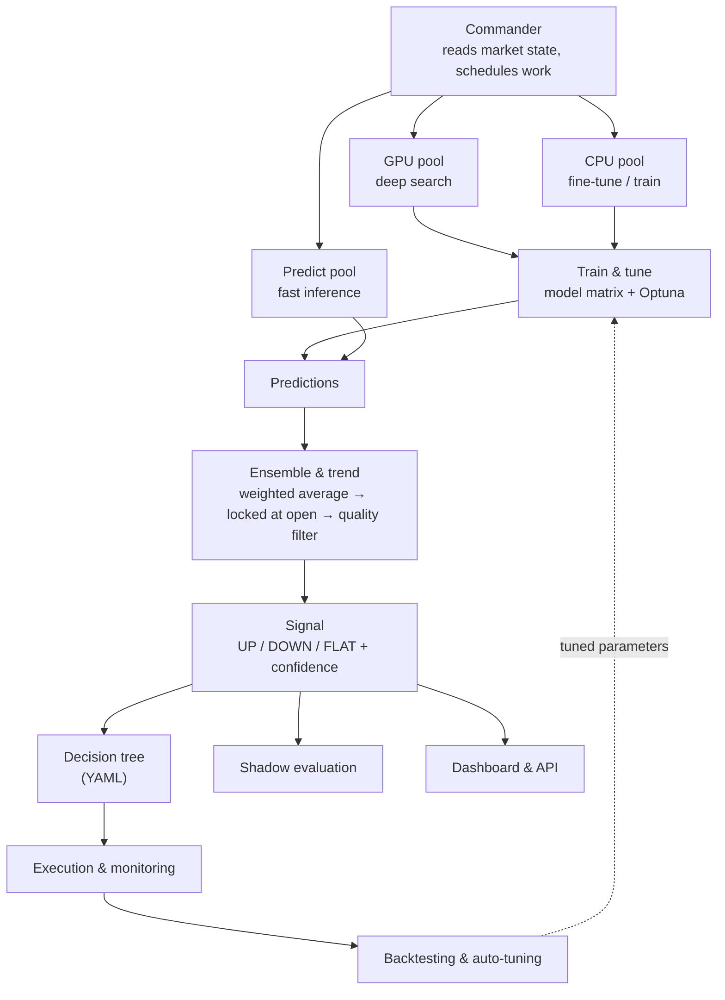

# ML Trading System — Showcase

Selected modules from a **private, end-to-end machine-learning trading system** I have designed and built on my own time since 2025. The system trains and tunes TensorFlow models, turns their ensemble forecasts into UP / DOWN / FLAT signals, and runs them through YAML-configured decision trees — with backtesting, shadow validation and risk controls along the way.

The full codebase stays private. This repository shares a few self-contained parts that show how it is engineered, without the strategy, data or deployment.

| | |
|---|---|
| **Scale** | ~1.7k commits · 300+ Python modules · 12 subsystems · 4-service Docker Compose stack |
| **Stack** | Python · TensorFlow / Keras · Optuna · scikit-learn · pandas · Flask · SQLite · Docker · NVIDIA GPU |
| **Since** | Q2 2025 — ongoing |

---

## How the system fits together



### Design principles

- **No lookahead bias** — predictions are frozen when the session opens and never updated retroactively.
- **Generalization gate** — tuning results must pass strict out-of-sample tests before they are used.
- **Shadow validation** — every blocking decision is scored against what would have happened.
- **Backtest–live parity** — backtests run the same decision logic, rules and timezone handling as live.
- **Instance isolation** — simulated and production instances run independently.
- **Modular strategies** — decision trees are YAML, so strategies change without code changes.
- **Data versioning** — version stamps invalidate cached backtests when logic changes.
- **Hot reload** — model matrix and parameters update without restarting containers.
- **Convergence-aware tuning** — optimisation stops when improvement plateaus.
- **Combo-level quality control** — Bayesian-shrunk scores filter unreliable models out of the ensemble.

### Timeline

| Quarter | Focus | Highlights |
|---|---|---|
| Q2 2025 | Foundation | Keras Tuner, attention models, data pipeline, first web dashboard |
| Q3 2025 | Data pipeline | SQLite rebuild, data-leakage prevention, timezone correctness, Optuna, Docker |
| Q4 2025 | Trading & risk | Decision trees, trend locking, shadow evaluation, regime detection, AI advisor |
| Q1 2026 | Hardening | Walk-forward testing, generalization gate, backtest–live parity, PWA dashboard |
| Q3 2026 | Ensembles | Seed ensembles with nightly warm-start retraining |

---

## What is in this repository

| Module | What it shows | Tests |
|---|---|---|
| [`mlsystem/decision_engine/`](mlsystem/decision_engine) | Engine for decision trees declared in YAML: immutable context, node registry, outcome-based transitions, decision trail. Includes a **toy example** tree and nodes. | `tests/test_decision_engine.py` |
| [`mlsystem/commander/`](mlsystem/commander) | Task model of the training orchestrator (priorities, lifecycle, task types) and a **thread-safe registry** that stops two workers training the same model combo. | `tests/test_commander.py` |
| [`mlsystem/gpu_assignment.py`](mlsystem/gpu_assignment.py) | Market-session-aware GPU/CPU assignment with automatic multi-GPU detection and graceful mode transitions. | — |
| [`mlsystem/feature_cache.py`](mlsystem/feature_cache.py) | Feature cache with content hashing and rolling-window pruning. | window settings: `tests/test_settings.py` |
| [`mlsystem/interval_data_cache.py`](mlsystem/interval_data_cache.py) | In-memory LRU cache for market data: memory limits, adaptive TTL by market state, thread safety. | `tests/test_interval_cache.py` |
| [`mlsystem/security/cloudflare_access.py`](mlsystem/security/cloudflare_access.py) | Verifying identity-proxy (Cloudflare Access) login tokens at the origin: signature, audience, issuer, expiry, allow-list. | `tests/test_cloudflare_access.py` |

### Intentionally not included

Strategy nodes and tuned parameters · broker and execution integration · risk controls · market data, predictions and model weights · infrastructure and deployment configuration · credentials of any kind.

In `mlsystem/commander/`, the model store, task generators and parameter-sharing helpers are **stubs** (clearly marked) standing in for private modules, and `config.py` holds demo values.

---

## Try it

```bash
python -m venv .venv && source .venv/bin/activate
pip install -r requirements.txt
pytest                                            # 25 tests
python -m mlsystem.decision_engine.examples.demo  # run the example decision tree
```

---

**Yu-Ting (Tim) Lin** · [timlin.me](https://timlin.me)

© 2026 Yu-Ting Lin. All rights reserved. This code is shared for reading and review only; no licence is granted to copy, modify or redistribute it.
