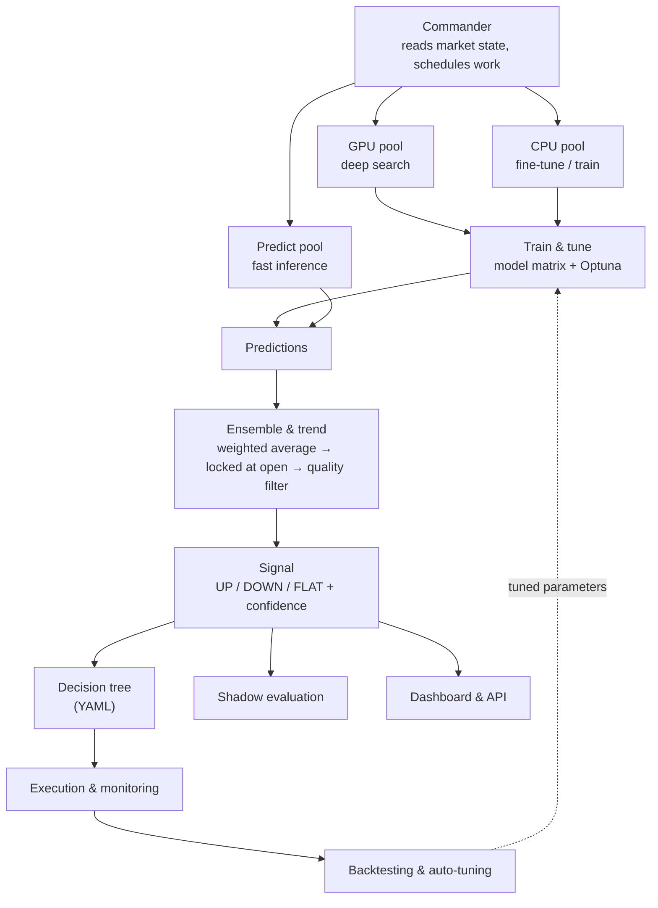
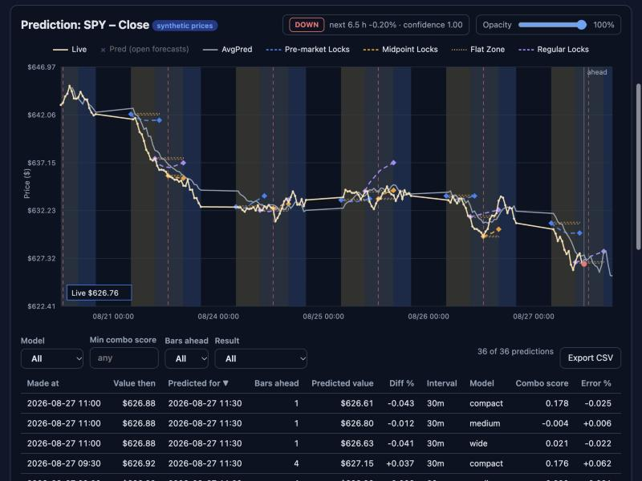
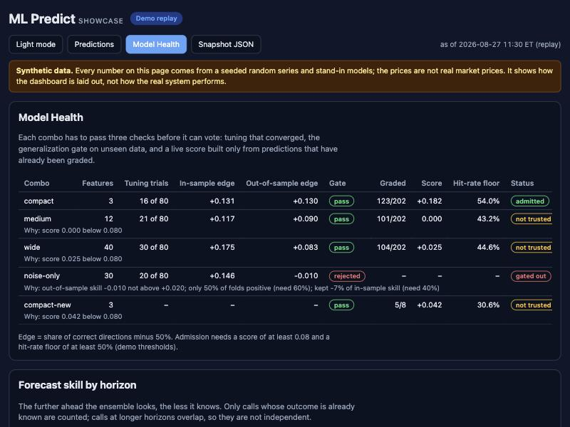

# ML Trading System — Showcase

Selected modules from a **private, end-to-end machine-learning trading system** I have designed and built on my own time since 2025. The system trains and tunes TensorFlow models, turns their ensemble forecasts into UP / DOWN / FLAT signals, and runs them through YAML-configured decision trees — with backtesting, shadow validation and risk controls along the way.

The full codebase stays private. This repository shares a few self-contained parts that show how it is engineered, without the strategy, data or deployment.

| | |
|---|---|
| **Scale** | ~1.7k commits · 300+ Python modules · 12 subsystems · 4-service Docker Compose stack |
| **Stack** | Python · TensorFlow / Keras · Optuna · scikit-learn · pandas · Flask · SQLite · Docker · NVIDIA GPU |
| **Since** | Q2 2025 — ongoing |

---

## How the system fits together



### Design principles

- **No lookahead bias** — predictions are frozen when the session opens and never updated retroactively.
- **Generalization gate** — tuning results must pass strict out-of-sample tests before they are used.
- **Shadow validation** — every blocking decision is scored against what would have happened.
- **Backtest–live parity** — backtests run the same decision logic, rules and timezone handling as live.
- **Instance isolation** — simulated and production instances run independently.
- **Modular strategies** — decision trees are YAML, so strategies change without code changes.
- **Data versioning** — version stamps invalidate cached backtests when logic changes.
- **Hot reload** — model matrix and parameters update without restarting containers.
- **Convergence-aware tuning** — optimisation stops when improvement plateaus.
- **Combo-level quality control** — Bayesian-shrunk scores filter unreliable models out of the ensemble.

### Timeline

| Quarter | Focus | Highlights |
|---|---|---|
| Q2 2025 | Foundation | Keras Tuner, attention models, data pipeline, first web dashboard |
| Q3 2025 | Data pipeline | SQLite rebuild, data-leakage prevention, timezone correctness, Optuna, Docker |
| Q4 2025 | Trading & risk | Decision trees, trend locking, shadow evaluation, regime detection, AI advisor |
| Q1 2026 | Hardening | Walk-forward testing, generalization gate, backtest–live parity, PWA dashboard |
| Q3 2026 | Ensembles | Seed ensembles with nightly warm-start retraining |

---

## What is in this repository

| Module | What it shows | Tests |
|---|---|---|
| [`mlsystem/quality/`](mlsystem/quality) | The statistics that decide which models are trusted: walk-forward splits with an embargo, the **generalization gate**, plateau-based early stopping for tuning, credibility-shrunk combo scores, and the score-weighted ensemble signal. Compact re-implementations for this showcase, with demo thresholds. | `tests/test_quality.py` |
| [`mlsystem/dashboard/`](mlsystem/dashboard) | A small Flask app with the **page layout of the system's web dashboard** — status header, indicator cards, session-shaded chart with live line, average prediction, locked forecast paths and flat zones, filterable prediction table, model-health page, JSON API — replaying synthetic data with no lookahead. | `tests/test_dashboard.py` |
| [`mlsystem/decision_engine/`](mlsystem/decision_engine) | Engine for decision trees declared in YAML: immutable context, node registry, outcome-based transitions, decision trail. Includes a **toy example** tree and nodes. | `tests/test_decision_engine.py` |
| [`mlsystem/commander/`](mlsystem/commander) | Task model of the training orchestrator (priorities, lifecycle, task types) and a **thread-safe registry** that stops two workers training the same model combo. | `tests/test_commander.py` |
| [`mlsystem/gpu_assignment.py`](mlsystem/gpu_assignment.py) | Market-session-aware GPU/CPU assignment with automatic multi-GPU detection and graceful mode transitions. | `tests/test_gpu_assignment.py` |
| [`mlsystem/feature_cache.py`](mlsystem/feature_cache.py) | Feature cache with content hashing and rolling-window pruning. | window settings: `tests/test_settings.py` |
| [`mlsystem/interval_data_cache.py`](mlsystem/interval_data_cache.py) | In-memory LRU cache for market data: memory limits, adaptive TTL by market state, thread safety. | `tests/test_interval_cache.py` |
| [`mlsystem/security/cloudflare_access.py`](mlsystem/security/cloudflare_access.py) | Verifying identity-proxy (Cloudflare Access) login tokens at the origin: signature, audience, issuer, expiry, allow-list. | `tests/test_cloudflare_access.py` |

### Intentionally not included

Strategy nodes and tuned parameters · broker and execution integration · risk controls · market data, predictions and model weights · infrastructure and deployment configuration · credentials of any kind.

In `mlsystem/commander/`, the model store, task generators and parameter-sharing helpers are **stubs** (clearly marked) standing in for private modules, and `config.py` holds demo values.

---

## Try it

```bash
python -m venv .venv && source .venv/bin/activate
pip install -r requirements.txt
pytest                                            # 69 tests
python -m mlsystem.quality.examples.pipeline_demo # tune -> gate -> score -> ensemble -> decide
python -m mlsystem.decision_engine.examples.demo  # the example decision tree on its own
python -m mlsystem.dashboard                      # demo dashboard at http://127.0.0.1:5057
```

### The pipeline demo

`pipeline_demo` runs the quality-control path end to end on **synthetic data** (fixed seed; a noisy series that depends weakly on 3 of 40 slow-moving features). Four ridge-regression "combos" stand in for the neural networks; one of them is given no real information at all.

```text
1) Tune each combo (random search, stops on plateau)
   compact     alpha=   5.487  best validation edge +0.067  stopped after 16 of 80 trials
   medium      alpha= 732.272  best validation edge +0.037  stopped after 21 of 80 trials
   wide        alpha=  94.418  best validation edge +0.077  stopped after 30 of 80 trials
   noise-only  alpha=   3.788  best validation edge +0.083  stopped after 20 of 80 trials

2) Generalization gate (walk-forward on data the tuner never saw)
   compact     in-sample +0.131  out-of-sample +0.130  -> PASS
   medium      in-sample +0.117  out-of-sample +0.090  -> PASS
   wide        in-sample +0.175  out-of-sample +0.083  -> PASS
   noise-only  in-sample +0.146  out-of-sample -0.010  -> REJECT: out-of-sample skill -0.010 not above +0.020; only 50% of folds positive (need 60%); kept -7% of in-sample skill (need 40%)

3) Grade the survivors on a live-style track record, then score them
   compact     156/250 hits  raw +0.248  shrunk +0.214  hit-rate floor 56.3%  -> admitted
   compact-new   7/8   hits  raw +0.750  shrunk +0.125  hit-rate floor 52.9%  -> admitted
   medium      134/250 hits  raw +0.072  shrunk +0.062  hit-rate floor 47.4%  -> score 0.062 below 0.080
   wide        129/250 hits  raw +0.032  shrunk +0.028  hit-rate floor 45.4%  -> score 0.028 below 0.080

4) Ensemble the admitted combos into one signal for the next step
   compact     forecast -1.218  weight 0.214
   compact-new forecast -1.218  weight 0.125
   signal: DOWN  confidence 1.00  forecast -1.218  (actual next value -1.913)

5) Hand the signal to the YAML decision tree
   Confidence -> PASS - 1.00 vs min 0.60      Final outcome: act
```

What to notice:

- **Early stopping** — every search ends well short of its 80-trial budget once it stops improving.
- **The gate** — the combo with no information looks fine in-sample (+0.146) and is rejected on out-of-sample evidence.
- **Passing the gate is not enough** — `medium` and `wide` got through, but their live track record is too weak, so they get no vote.
- **Shrinkage** — `compact-new` has the best raw average (+0.750) from only 8 graded predictions; it is cut to +0.125, a little over half the weight of the proven `compact`.

The numbers describe the synthetic series only. They say nothing about the performance of the real system, which is deliberately not published here.

### The demo dashboard

`python -m mlsystem.dashboard` serves a miniature of the system's web UI. The layout follows the real dashboard; the content is the synthetic pipeline above, replayed one 30-minute bar every few seconds over trading sessions dated August 2026. The target is labelled SPY, as on the real system, but **the prices are synthetic, not SPY's**.



- **The chart reads like the real one** — pre-market, regular and post-market sessions are shaded; *Live* stops at "now"; *AvgPred*, the average of every forecast for a bar, runs on past it; individual open forecasts can be switched on from the legend.
- **Locks** — at the pre-market open, the regular open and the session midpoint, the ensemble's forecast path is frozen and drawn as a dashed line with its flat zone. A lock is never redrawn afterwards, which is how the real system avoids grading itself on revised predictions.
- **Forecasts reach ahead** — every combo forecasts 30 minutes to 6.5 hours ahead with one directly fitted model per horizon.
- **Predictions page** — the trend expected next, how earlier trend calls turned out, how many combos are in the ensemble, and the decision-tree trail; below the chart, a sortable, filterable table of graded predictions by horizon, with CSV export.
- **Model Health page** — every combo with its tuning effort, in-sample vs. out-of-sample skill, gate verdict, live score and the reason it is or is not allowed to vote; plus forecast skill by horizon, which fades the further ahead the ensemble looks.
- **No lookahead in the replay** — a combo's weight uses only predictions already graded, and a model for horizon *h* is never trained on a label that ends after its training window; `tests/test_dashboard.py` rewrites every later bar and checks the page does not change, and that a lock made earlier is identical in later snapshots.
- **No external assets** — the chart is inline SVG and the page loads nothing from a CDN.



The real dashboard is far larger (live market data, trade analytics, tuning and backtest views, authentication). None of that is included; the screenshots show synthetic numbers only.

---

**Yu-Ting (Tim) Lin** · [timlin.me](https://timlin.me)

© 2026 Yu-Ting Lin. All rights reserved. This code is shared for reading and review only; no licence is granted to copy, modify or redistribute it.
