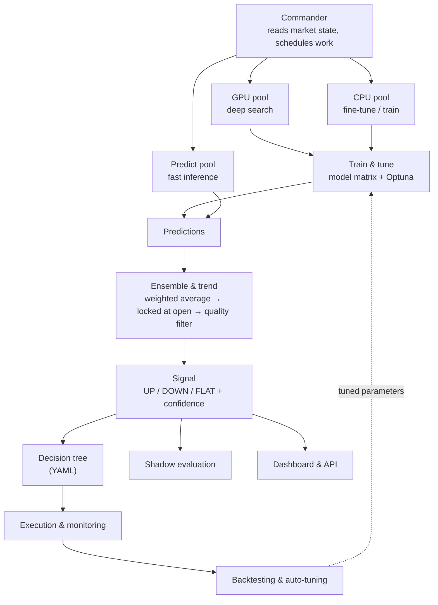

# ML Trading System — Showcase

Selected modules from a **private, end-to-end machine-learning trading system** I have designed and built on my own time since 2025. The system trains and tunes TensorFlow models, turns their ensemble forecasts into UP / DOWN / FLAT signals, and runs them through YAML-configured decision trees — with backtesting, shadow validation and risk controls along the way.

The full codebase stays private. This repository shares a few self-contained parts that show how it is engineered, without the strategy, data or deployment.

| | |
|---|---|
| **Scale** | ~1.7k commits · 300+ Python modules · 12 subsystems · 4-service Docker Compose stack |
| **Stack** | Python · TensorFlow / Keras · Optuna · scikit-learn · pandas · Flask · SQLite · Docker · NVIDIA GPU |
| **Since** | Q2 2025 — ongoing |

---

## How the system fits together



### Design principles

- **No lookahead bias** — predictions are frozen when the session opens and never updated retroactively.
- **Generalization gate** — tuning results must pass strict out-of-sample tests before they are used.
- **Shadow validation** — every blocking decision is scored against what would have happened.
- **Backtest–live parity** — backtests run the same decision logic, rules and timezone handling as live.
- **Instance isolation** — simulated and production instances run independently.
- **Modular strategies** — decision trees are YAML, so strategies change without code changes.
- **Data versioning** — version stamps invalidate cached backtests when logic changes.
- **Hot reload** — model matrix and parameters update without restarting containers.
- **Convergence-aware tuning** — optimisation stops when improvement plateaus.
- **Combo-level quality control** — Bayesian-shrunk scores filter unreliable models out of the ensemble.

### Timeline

| Quarter | Focus | Highlights |
|---|---|---|
| Q2 2025 | Foundation | Keras Tuner, attention models, data pipeline, first web dashboard |
| Q3 2025 | Data pipeline | SQLite rebuild, data-leakage prevention, timezone correctness, Optuna, Docker |
| Q4 2025 | Trading & risk | Decision trees, trend locking, shadow evaluation, regime detection, AI advisor |
| Q1 2026 | Hardening | Walk-forward testing, generalization gate, backtest–live parity, PWA dashboard |
| Q3 2026 | Ensembles | Seed ensembles with nightly warm-start retraining |

---

## What is in this repository

| Module | What it shows | Tests |
|---|---|---|
| [`mlsystem/quality/`](mlsystem/quality) | The statistics that decide which models are trusted: walk-forward splits with an embargo, the **generalization gate**, plateau-based early stopping for tuning, credibility-shrunk combo scores, and the score-weighted ensemble signal. Compact re-implementations for this showcase, with demo thresholds. | `tests/test_quality.py` |
| [`mlsystem/dashboard/`](mlsystem/dashboard) | A small Flask app with the **page layout of the system's web dashboard** — status header, indicator cards, prediction chart and filterable table, model-health page, JSON API — replaying synthetic data with no lookahead. | `tests/test_dashboard.py` |
| [`mlsystem/decision_engine/`](mlsystem/decision_engine) | Engine for decision trees declared in YAML: immutable context, node registry, outcome-based transitions, decision trail. Includes a **toy example** tree and nodes. | `tests/test_decision_engine.py` |
| [`mlsystem/commander/`](mlsystem/commander) | Task model of the training orchestrator (priorities, lifecycle, task types) and a **thread-safe registry** that stops two workers training the same model combo. | `tests/test_commander.py` |
| [`mlsystem/gpu_assignment.py`](mlsystem/gpu_assignment.py) | Market-session-aware GPU/CPU assignment with automatic multi-GPU detection and graceful mode transitions. | `tests/test_gpu_assignment.py` |
| [`mlsystem/feature_cache.py`](mlsystem/feature_cache.py) | Feature cache with content hashing and rolling-window pruning. | window settings: `tests/test_settings.py` |
| [`mlsystem/interval_data_cache.py`](mlsystem/interval_data_cache.py) | In-memory LRU cache for market data: memory limits, adaptive TTL by market state, thread safety. | `tests/test_interval_cache.py` |
| [`mlsystem/security/cloudflare_access.py`](mlsystem/security/cloudflare_access.py) | Verifying identity-proxy (Cloudflare Access) login tokens at the origin: signature, audience, issuer, expiry, allow-list. | `tests/test_cloudflare_access.py` |

### Intentionally not included

Strategy nodes and tuned parameters · broker and execution integration · risk controls · market data, predictions and model weights · infrastructure and deployment configuration · credentials of any kind.

In `mlsystem/commander/`, the model store, task generators and parameter-sharing helpers are **stubs** (clearly marked) standing in for private modules, and `config.py` holds demo values.

---

## Try it

```bash
python -m venv .venv && source .venv/bin/activate
pip install -r requirements.txt
pytest                                            # 64 tests
python -m mlsystem.quality.examples.pipeline_demo # tune -> gate -> score -> ensemble -> decide
python -m mlsystem.decision_engine.examples.demo  # the example decision tree on its own
python -m mlsystem.dashboard                      # demo dashboard at http://127.0.0.1:5057
```

### The pipeline demo

`pipeline_demo` runs the quality-control path end to end on **synthetic data** (fixed seed; a noisy series that depends weakly on 3 of 40 features). Four ridge-regression "combos" stand in for the neural networks; one of them is given no real information at all.

```text
1) Tune each combo (random search, stops on plateau)
   compact     alpha=  20.226  best validation edge +0.123  stopped after 24 of 80 trials
   medium      alpha=  57.119  best validation edge +0.097  stopped after 33 of 80 trials
   wide        alpha=   0.979  best validation edge +0.067  stopped after 19 of 80 trials
   noise-only  alpha=   0.887  best validation edge +0.003  stopped after 16 of 80 trials

2) Generalization gate (walk-forward on data the tuner never saw)
   compact     in-sample +0.121  out-of-sample +0.130  -> PASS
   medium      in-sample +0.144  out-of-sample +0.097  -> PASS
   wide        in-sample +0.236  out-of-sample +0.117  -> PASS
   noise-only  in-sample +0.181  out-of-sample +0.033  -> REJECT: kept 18% of in-sample skill (need 40%)

3) Grade the survivors on a live-style track record, then score them
   compact     152/250 hits  raw +0.216  shrunk +0.186  hit-rate floor 54.6%  -> admitted
   medium      152/250 hits  raw +0.216  shrunk +0.186  hit-rate floor 54.6%  -> admitted
   wide        150/250 hits  raw +0.200  shrunk +0.172  hit-rate floor 53.8%  -> admitted
   compact-new   5/8   hits  raw +0.250  shrunk +0.042  hit-rate floor 30.6%  -> score 0.042 below 0.080

4) Ensemble the admitted combos into one signal for the next step
   compact     forecast +0.000  weight 0.186
   medium      forecast +0.140  weight 0.186
   wide        forecast -1.086  weight 0.172
   signal: DOWN  confidence 0.32  forecast -0.296  (actual next value -1.153)

5) Hand the signal to the YAML decision tree
   Confidence -> FAIL - 0.32 vs min 0.60      Final outcome: skip
```

What to notice:

- **Early stopping** — every search ends well short of its 80-trial budget once it stops improving.
- **The gate** — the combo with no information looks fine in-sample (+0.181) and is rejected on out-of-sample evidence.
- **Shrinkage** — `compact-new` has the best raw average, but only 8 graded predictions, so it is not trusted yet.
- **Disagreement** — the ensemble leans DOWN, but the members are split, so confidence is low and the decision tree declines to act.

The numbers describe the synthetic series only. They say nothing about the performance of the real system, which is deliberately not published here.

### The demo dashboard

`python -m mlsystem.dashboard` serves a miniature of the system's web UI. The layout follows the real dashboard; the content is the synthetic pipeline above, replayed one bar every few seconds.


- **Predictions page** — signal for the next bar, recent directional calls, how many combos are in the ensemble, and the decision-tree trail; below that, actual vs. ensemble prediction and a sortable, filterable table of graded predictions with CSV export.
- **Model Health page** — every combo with its tuning effort, in-sample vs. out-of-sample skill, gate verdict, live score and the reason it is or is not allowed to vote.
- **No lookahead in the replay** — at each bar a combo's weight is computed only from predictions already graded at that moment; `tests/test_dashboard.py` rewrites the future and checks the weights do not move.
- **No external assets** — the chart is inline SVG and the page loads nothing from a CDN.


The real dashboard is far larger (live market data, trade analytics, tuning and backtest views, authentication). None of that is included; the screenshots show synthetic numbers only.

---

**Yu-Ting (Tim) Lin** · [timlin.me](https://timlin.me)

© 2026 Yu-Ting Lin. All rights reserved. This code is shared for reading and review only; no licence is granted to copy, modify or redistribute it.
